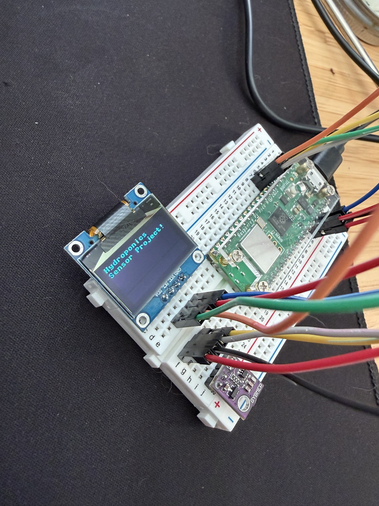
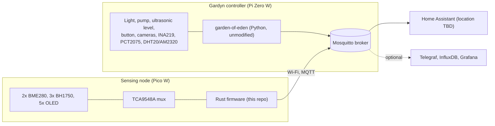

# hydroponics_sensing

Sensing temperature, humidity, pressure and light for a revived Gardyn indoor vertical
garden. The stock Gardyn controller keeps running the pump and lights. A separate
Raspberry Pi Pico W, running Rust firmware from this repo, adds the sensors and displays
and publishes everything to MQTT.

**Status:** documentation done; bench bring-up started (OLED on the Pico works). No firmware yet. See [roadmap](docs/roadmap.md) and
[open questions](docs/open-questions.md).

## First power

*2026-10-10: the Pico driving an OLED on the bench. Details and next photos: [build log](docs/build-log.md).*

## System diagram

## Hardware summary

| Node | Hardware | Job |
|---|---|---|
| Gardyn controller | Pi Zero W v1.1 on the Gardyn PCB | Light, pump, water level, button, cameras, stock sensors, MQTT broker |
| Sensing node | Pico W (RP2040) | 2x BME280, 3x BH1750, 5x OLED, publishes over Wi-Fi |

Full list with status: [bill of materials](docs/hardware/bill-of-materials.md).

## Documentation

| Area | Docs |
|---|---|
| Progress | [build log](docs/build-log.md) (photos and the shot list) |
| Design | [architecture](docs/architecture.md), [decisions (ADRs)](docs/decisions/), [roadmap](docs/roadmap.md), [open questions](docs/open-questions.md) |
| Hardware | [BOM](docs/hardware/bill-of-materials.md), [I2C address map](docs/hardware/i2c-address-map.md), [wiring](docs/hardware/wiring.md), [Pi Zero health check](docs/hardware/pi-zero-health-check.md), [plumbing](docs/hardware/plumbing.md), [sensor bring-up](docs/hardware/sensor-bringup.md) |
| Software | [Pi setup](docs/software/pi-setup.md), [Pico firmware](docs/software/pico-firmware.md), [MQTT topics](docs/software/mqtt-topics.md) |
| Operations | [calibration](docs/operations/calibration.md), [maintenance](docs/operations/maintenance.md), [troubleshooting](docs/operations/troubleshooting.md) |
| Reference | [original implementation guide](docs/reference/implementation-guide.md) |

## Upstream and licence

The Gardyn side is [iot-root/garden-of-eden](https://github.com/iot-root/garden-of-eden)
(GPL-3.0), used unmodified and never copied into this repo. See [CLAUDE.md](CLAUDE.md)
for the working rules.
