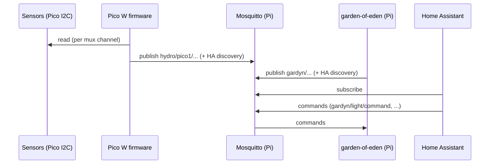

# Architecture

## Two nodes

| Node | Runs | Owns |
|---|---|---|
| Gardyn controller (Pi Zero W) | garden-of-eden, pigpiod, Mosquitto | Light (PWM GPIO18), pump (PWM GPIO24), ultrasonic level (GPIO19 echo, GPIO26 trigger), button (GPIO13), over-temp alert (GPIO25), cameras, I2C bus 1 stock sensors |
| Sensing node (Pico W) | Rust firmware (planned) | BME280 x2, BH1750 x3, OLED x5, behind a TCA9548A mux |

Pins from garden-of-eden `config.py` and `.env-dist`.

## Data flow

The two nodes never talk directly. The broker on the Pi is the only integration point
([ADR 0005](decisions/0005-mqtt-integration.md)).

## Where Home Assistant runs

Home Assistant runs on the Latitude 7490, with NextCloud (decided 2026-10-10). The 7490 is planned
for the Servers VLAN (switch port 4); the Pi Zero W and Pico W are planned for IoT (see
[open-questions.md](open-questions.md), D4). Per the
[segmentation design](https://github.com/uploadtigris/network-segmentation-ids), Servers cannot start
connections into other VLANs, and IoT is limited to DNS (Pi-hole) and the internet. So HA and the
broker cannot talk by default, and one narrow rule is needed. Two ways to do it:

| Option | Rule needed | Effect |
|---|---|---|
| A. Broker stays on the Pi Zero W | Servers to IoT: pass TCP 1883 from the 7490 to the Pi | Servers starts a connection into IoT, which the design currently forbids |
| B. Broker moves to the 7490 (Mosquitto beside HA); the Pi and Pico publish to it | IoT to Servers: pass TCP 1883 from the Pi and Pico to the 7490 only | One-way, host-specific, same pattern as the Wazuh exception. Needs `MQTT_BROKER` in the Pi's `.env` pointed at the 7490. The 7490 is also the always-on box, so the broker is not tied to a possibly unhealthy Pi |

Leaning towards **B**, but **not decided**: the owner chooses. Until then the rest of these docs
describe the broker on the Pi, and the diagrams stay as they are. Garden-of-eden keeps running its
pump and light schedule locally whichever option is picked.

## Why split

- garden-of-eden already provides REST, web UI (`http://gardyn.local:5000/`), MQTT and Home
  Assistant discovery. Rewriting pump and light control gains nothing and risks a dry-run pump.
- The Pi's I2C bus 1 already carries 3 Gardyn devices and its header is soldered into the Gardyn
  PCB. Adding sensors there means soldering onto a board of unknown health.
- The Pico W has two hardware I2C controllers plus PIO, and the mux removes address clashes.

See [ADR 0001](decisions/0001-two-node-split.md).

## Failure modes

| Failure | Effect | Behaviour to build in |
|---|---|---|
| Pico Wi-Fi drops | No new `hydro/` data; Gardyn unaffected | Firmware reconnects with backoff, keeps showing last readings on OLED marked stale; MQTT last-will marks it offline |
| Broker (Pi) down | Both nodes lose MQTT; garden-of-eden pump/light schedule still runs locally; HA sees nothing | Pico retries connect; no data buffering in v1 (TBD, see open-questions.md) |
| Pi Zero W dies | No pump or light control, no broker | Pico keeps sensing and displaying; publishing fails until broker returns |
| One sensor missing or failing | Gardyn: endpoint returns 503 and drivers re-probe (`docs/design.md` upstream). Pico: that channel only | Mark that metric unavailable, do not publish zeros, keep other channels running |
| Mux channel bus stuck | All devices on that channel lost | Reset via TCA9548A RESET pin, re-select channel; other channels continue |
| Pump runs dry | Pump damage | garden-of-eden caps run time (`MAX_PUMP_RUN_SECONDS`, default 900) and water-low alert; a human check is still required |
| Power loss | Gardyn restores actuator and grow state on boot (upstream `docs/design.md`) | Pico boots, rejoins Wi-Fi, re-sends HA discovery |

## Not in scope yet

A Rust service on the Pi (aggregator or logger). If added, see the ARMv6 note in
[CLAUDE.md](../CLAUDE.md).
