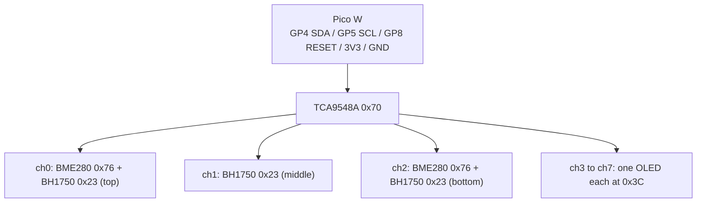

# Wiring

## Pico W pin assignments (proposed)

Pico pin numbers are physical pins. GPIO-to-pin mapping is from the Raspberry Pi Pico pinout;
confirm against the [Pico W datasheet](https://datasheets.raspberrypi.com/picow/pico-w-datasheet.pdf)
before soldering.

| Signal | GPIO | Physical pin | Goes to |
|---|---|---|---|
| I2C0 SDA | GP4 | 6 | TCA9548A SDA (upstream) |
| I2C0 SCL | GP5 | 7 | TCA9548A SCL (upstream) |
| Mux RESET (active low) | GP8 | 11 | TCA9548A RESET |
| I2C1 SDA (fallback only) | GP6 | 9 | |
| I2C1 SCL (fallback only) | GP7 | 10 | |
| 3V3 | n/a | 36 | All sensor VCC |
| GND | n/a | 38 (or any GND) | All sensor GND |

Power everything from the 3V3 pin. Pico GPIO is **not** 5 V tolerant, so do not power the
mux upstream side from 5 V.

## Mux channels

Each channel has its own SDn / SCn pair (n = 0 to 7) to its devices. See
[i2c-address-map.md](i2c-address-map.md) for what goes on each.

## Gardyn Pi GPIO usage (from garden-of-eden `config.py` / `.env-dist`, BCM numbering)

| Function | BCM pin | Notes |
|---|---|---|
| Grow light | 18 | PWM, 8 kHz (`LIGHT_FREQUENCY`) |
| Pump | 24 | PWM, 50 Hz (`PUMP_FREQUENCY`) |
| Ultrasonic echo | 19 | |
| Ultrasonic trigger | 26 | |
| Button | 13 | |
| Over-temp alert | 25 | `OVER_TEMP_ALERT_PIN` |
| I2C bus 1 | GPIO2 SDA (pin 3), GPIO3 SCL (pin 5) | INA219, PCT2075, DHT20/AM2320 |

Leave pins at defaults.

## Power budget

| Item | Current | Status |
|---|---|---|
| OLED | about 20 mA each (guide estimate) | Measure; with 5 OLEDs about 100 mA |
| BME280, BH1750, TCA9548A | not yet totalled | TBD, from datasheets |
| Pico 3V3 pin capacity | not verified | TBD, check Pico datasheet before finalising |
| Pico W itself over Wi-Fi | not measured | TBD |

How the Pico is powered (USB supply or a tap from the Gardyn PSU) is open; see
[open-questions.md](../open-questions.md).

## Physical mounting (TBD)

| Item | Intended place | Status |
|---|---|---|
| BH1750 x3 | Canopy heights: top, middle, bottom | Heights TBD |
| BME280 x2 | Top and bottom, or one near the reservoir and one in ambient air | TBD |
| Mux | Near the Pico, keep each channel run short | TBD |
| Cabling | Away from water, drip loops, strain relief | |
| OLEDs | Where visible | TBD |
